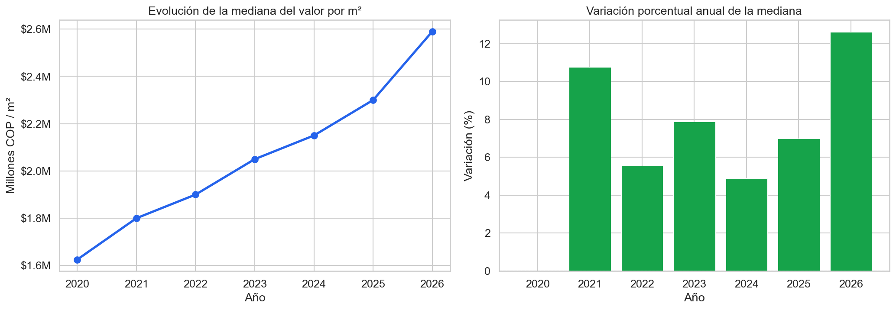
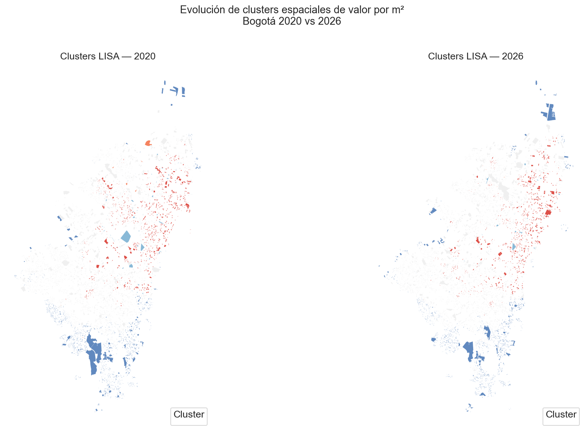
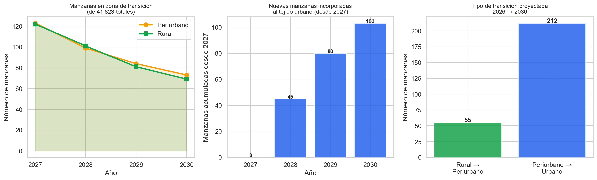
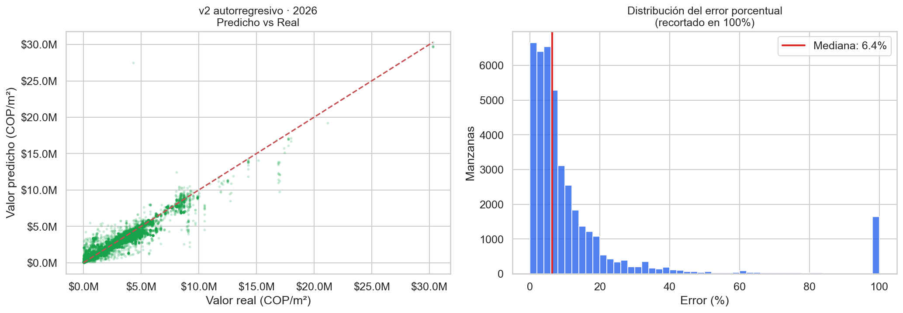

# 🏙️ Análisis del mercado inmobiliario urbano — Bogotá D. C. (v2)


## 📊 Vista del proyecto



Los análisis completos están en [`notebooks/`](notebooks/) y las figuras exportadas en [`reports/figures/`](reports/figures/).

---

## 📋 Descripción

Análisis geoespacial del **valor de referencia del terreno por manzana** en Bogotá durante **2020–2026**, a partir de información catastral de la UAECD/IDECA. El proyecto reúne carga a PostgreSQL/PostGIS, exploración, análisis espacial y temporal, comparación de modelos y una proyección exploratoria de expansión urbana a 2030.

**Pregunta de análisis:** ¿Cómo cambia el valor de referencia del suelo entre localidades y años, y cuánto mejora un modelo predictivo frente a repetir el valor del año anterior?

> El valor de referencia por manzana no equivale al valor comercial de un predio individual. Los resultados y métricas que aparecen abajo provienen de las salidas guardadas en los notebooks y los [metadatos del modelo](models/modelo_v2_metadata.json); no se recalcularon al preparar esta publicación.

---

## 🎯 Hallazgos principales

| Indicador | Resultado documentado | Alcance |
|---|---:|---|
| Registros analizados | **299.482** | Serie 2020–2026 del [informe final](notebooks/06_informe_final.ipynb) |
| Manzanas únicas | **44.100** | Base limpia descrita en el informe final |
| Localidades | **20** | Cobertura de Bogotá en el informe final |
| Modelo v2: R² | **0,9168** | Prueba temporal: entrenamiento hasta 2025, evaluación en 2026 |
| Modelo v2: MAE | **$259.830 COP/m²** | 41.519 observaciones de prueba |
| Referencia sencilla: MAE | **$315.489 COP/m²** | Repetir el valor del año anterior; mejora del modelo: **$55.659 COP/m²** |

La comparación del modelo se detalla en [`04b_comparacion_modelos.ipynb`](notebooks/04b_comparacion_modelos.ipynb). La predicción requiere conocer el valor de la manzana en el año anterior y no reemplaza un avalúo comercial.

---

## 🗺️ Visualizaciones

| Evolución temporal | Patrones espaciales |
|---|---|
|  |  |
| Valores por año en Bogotá | Agrupaciones espaciales entre 2020 y 2026 |
|  |  |
| Proyección exploratoria de estados territoriales | Distribución de errores de la evaluación temporal |

---

## 🛠️ Stack tecnológico

| Categoría | Herramientas |
|---|---|
| Lenguaje | Python 3.12 |
| Base de datos | PostgreSQL 18 · PostGIS |
| Análisis geoespacial | GeoPandas · Shapely · PyProj · Folium |
| Análisis y modelado | Pandas · NumPy · scikit-learn · XGBoost · MGWR · SHAP |
| Visualización | Matplotlib · Seaborn · Plotly |
| Trabajo reproducible | Jupyter · SQLAlchemy · Git · GitHub |

Las dependencias declaradas están en [`requirements.txt`](requirements.txt).

---

## 📁 Estructura del proyecto

```text
colombia-mercado-inmobiliario_v2/
├── avaluo/             # Consulta de fuentes, sustento y evaluación general
├── data/README.md      # Datos requeridos; archivos pesados excluidos
├── models/             # Metadatos; modelo binario excluido
├── notebooks/          # Siete análisis, de EDA a informe final
├── reports/figures/    # Figuras PNG exportadas
├── sql/                # Esquema principal de PostGIS
├── src/                # Scripts de carga y transformación
├── .env.example        # Variables de conexión, sin credenciales
└── requirements.txt
```

Los documentos de un expediente predial, propuestas comerciales, respaldos de bases y mapas HTML grandes permanecen fuera del repositorio público.

---

## 🔄 Metodología

1. **Ingesta:** carga de shapefiles de valor de referencia y capas auxiliares a PostGIS con los scripts de [`src/`](src/).
2. **Exploración:** revisión de cobertura temporal, calidad de datos y distribución de valores en [`01_exploracion_eda.ipynb`](notebooks/01_exploracion_eda.ipynb).
3. **Análisis espacial y temporal:** patrones entre manzanas y localidades, series anuales y comparación con IPC en los notebooks 02 y 03.
4. **Modelado:** comparación de enfoques con referencias sencillas y evaluación temporal hasta 2025 → 2026 en los notebooks 04 y 04b.
5. **Síntesis:** proyección exploratoria a 2030 e informe final en los notebooks 05 y 06.

---

## ⚙️ Reproducibilidad

```bash
git clone https://github.com/kenpama28-commits/colombia-mercado-inmobiliario_v2.git
cd colombia-mercado-inmobiliario_v2
python -m venv .venv
pip install -r requirements.txt
```

Activa el entorno virtual según tu sistema operativo. Antes de ejecutar ETL o notebooks, prepara PostgreSQL con PostGIS, carga los datos indicados en [`data/README.md`](data/README.md) y define `PGHOST`, `PGPORT`, `PGDATABASE`, `PGUSER` y `PGPASSWORD` en el entorno. [`.env.example`](.env.example) muestra los nombres; el código **no carga automáticamente** un archivo `.env`.

Los notebooks esperan la tabla `catastro.valor_manzana` y deben abrirse desde `notebooks/` para resolver `../src`. Sin los datos y la base local se pueden revisar sus salidas guardadas, pero no reproducir la ejecución completa. Este repositorio no tiene remoto DVC configurado.

---

## 📂 Fuentes de datos

| Conjunto | Fuente documentada | Uso |
|---|---|---|
| Valor de referencia por manzana, 2020–2026 | UAECD / IDECA | Serie catastral principal |
| Localidades y sectores de Bogotá | Datos distritales y DANE | Agregación y contexto espacial |
| Capas de transporte, seguridad y norma urbana | Fuentes distritales | Variables auxiliares del análisis |

Los archivos de datos no se publican por tamaño. Consulta [`data/README.md`](data/README.md) para la estructura local esperada.

---

## 👤 Autor

**Kevin Palacio** · [Portafolio en GitHub](https://github.com/kenpama28-commits)

*Fuente principal: UAECD / IDECA, Bogotá D. C. Las métricas corresponden a los resultados documentados del proyecto.*
